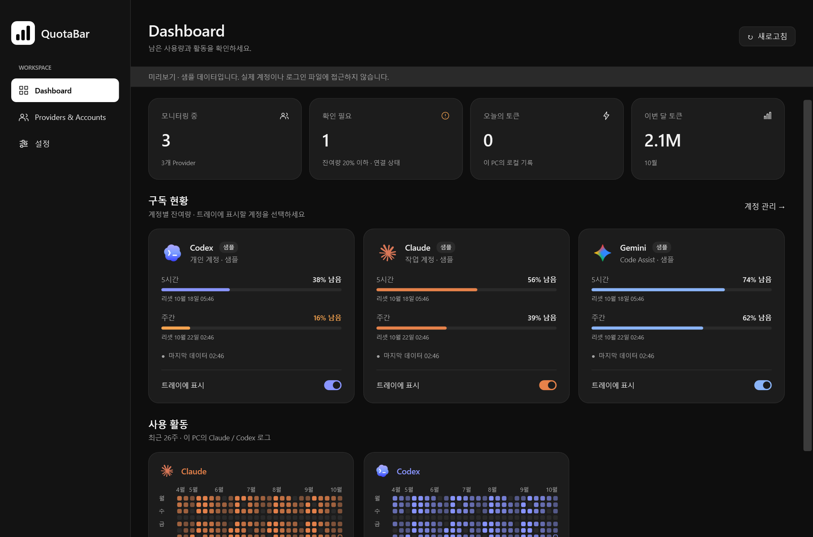

# QuotaBar

**Codex · Claude · Gemini의 남은 사용량을 한곳에서 확인하세요.**

QuotaBar는 계정별 잔여 한도와 초기화 시간을 메뉴바와 트레이에 표시하는 데스크톱 앱입니다. 상세 사용량, 계정 관리와 로컬 사용 활동은 Dashboard에서 확인할 수 있습니다.

**[Windows 다운로드](https://github.com/zjxps2007/quotabar/releases/download/v0.2.0/QuotaBar-0.2.0-Windows-x64-Setup.exe)** · **[Apple Silicon Mac 다운로드](https://github.com/zjxps2007/quotabar/releases/download/v0.2.0/QuotaBar-0.2.0-macOS-arm64.zip)** · [릴리즈 노트](https://github.com/zjxps2007/quotabar/releases/tag/v0.2.0)

*Windows 다크 모드의 샘플 화면입니다.*

## 주요 기능

- **메뉴바·트레이 요약:** 계정별 남은 한도와 초기화 시간을 빠르게 확인합니다.
- **여러 계정 관리:** 계정 연결, 이름 변경, 일시 정지와 개별 새로고침을 지원합니다.
- **사용 활동:** Codex·Claude의 오늘·이번 달 토큰과 최근 26주 활동을 보여줍니다.
- **라이트·다크 테마:** 시스템 테마에 맞추거나 원하는 화면 모드를 선택합니다.
- **백그라운드 모니터링:** Dashboard를 닫아도 사용량 조회를 계속합니다.
- **자동 새로고침·업데이트:** 조회 주기를 설정하고 새 버전을 확인·설치합니다.

## 다운로드

| 플랫폼 | 다운로드 |
| --- | --- |
| Windows 10/11 x64 | [설치 EXE](https://github.com/zjxps2007/quotabar/releases/download/v0.2.0/QuotaBar-0.2.0-Windows-x64-Setup.exe) · [포터블 ZIP](https://github.com/zjxps2007/quotabar/releases/download/v0.2.0/QuotaBar-0.2.0-Windows-x64.zip) |
| macOS 14 이상 · Apple Silicon | [앱 ZIP](https://github.com/zjxps2007/quotabar/releases/download/v0.2.0/QuotaBar-0.2.0-macOS-arm64.zip) |

Windows는 설치 EXE를 실행한 뒤 시작 메뉴에서 **QuotaBar**를 엽니다. Mac은 ZIP을 풀고 **QuotaBar.app**을 응용 프로그램 폴더로 옮겨 실행합니다.

자세한 설치·계정 연결 방법은 [Windows 안내](windows/README.md)와 [macOS 안내](macos/README.md)를 참고하세요.

## 시작하기

1. **Providers & Accounts → 계정 연결**에서 계정을 추가합니다.
2. **Dashboard**에서 남은 사용량과 초기화 시간을 확인합니다.
3. 메뉴바·트레이에 표시할 계정과 새로고침 주기를 설정합니다.

Windows에서는 트레이 아이콘을 **우클릭**하면 사용량과 **Dashboard 열기 · 종료** 메뉴가 표시됩니다.

## 지원하는 연결

| 서비스 | 연결 방법 |
| --- | --- |
| Codex | 공식 CLI를 이용한 브라우저 로그인 또는 기존 로그인 파일 |
| Claude Code | 로그인한 CLI 설정 폴더의 status line 연결 |
| Gemini | Code Assist에서 허용하는 계정의 로그인 파일 |

로컬 활동은 현재 기기의 기록이며, 계정별 청구 사용량이나 비용으로 환산하지 않습니다.

## 라이선스

[Apache-2.0](LICENSE). [sylearn/AIUsage](https://github.com/sylearn/AIUsage)의 Provider 조회 기능에서 출발한 프로젝트입니다. 출처와 변경 고지는 [NOTICE](NOTICE)에 있습니다.
