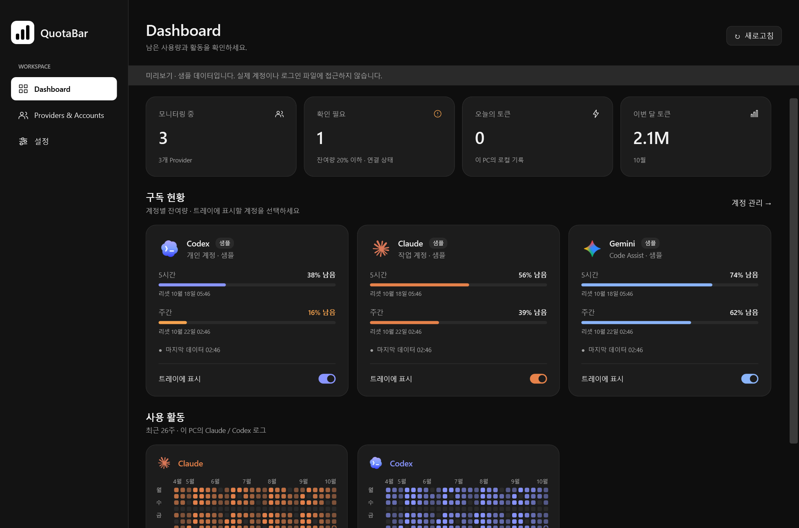

# QuotaBar

**AI 코딩 도구의 남은 사용량을 메뉴바와 트레이에서 확인하세요.**

QuotaBar는 **Codex · Claude · Gemini**의 계정별 잔여 한도와 초기화 시간을 한곳에서 보여주는 데스크톱 앱입니다. 여러 계정을 오가며 사용량을 확인하는 대신, 작업 중인 화면에서 남은 한도를 살펴보고 필요할 때 Dashboard를 열 수 있습니다.

**[Windows 설치 EXE 다운로드](https://github.com/zjxps2007/quotabar/releases/download/v0.2.2/QuotaBar-0.2.2-Windows-x64-Setup.exe)** · [릴리즈 노트](https://github.com/zjxps2007/quotabar/releases/tag/v0.2.2) · [macOS 사용 안내](macos/README.md)

*Windows 다크 모드의 샘플 화면입니다. 표시된 계정과 사용량은 미리보기 데이터입니다.*

## 주요 기능

- **남은 사용량을 한눈에:** 계정별 한도, 남은 비율, 초기화 시각을 확인합니다.
- **여러 계정을 함께 관리:** 개인·업무 계정을 연결하고 이름 변경, 일시 정지, 개별 새로고침을 할 수 있습니다.
- **메뉴바와 트레이 표시:** 표시할 계정을 선택하고, 창을 닫아도 남은 사용량을 계속 확인합니다.
- **사용 활동 돌아보기:** Codex·Claude의 로컬 기록을 바탕으로 오늘·이번 달 토큰과 최근 26주 활동을 보여줍니다.
- **라이트·다크 테마:** macOS와 Windows에서 같은 디자인으로 사용하며 시스템 테마를 따를 수 있습니다.
- **필요할 때 여는 Dashboard:** 상세 창을 닫으면 화면 프로세스가 종료되고 사용량 모니터링은 계속됩니다.

## 다운로드

| 플랫폼 | 설치 방법 | 현재 제공 형태 |
| --- | --- | --- |
| Windows 10/11 x64 | [설치 EXE](https://github.com/zjxps2007/quotabar/releases/download/v0.2.2/QuotaBar-0.2.2-Windows-x64-Setup.exe) · [포터블 ZIP](https://github.com/zjxps2007/quotabar/releases/download/v0.2.2/QuotaBar-0.2.2-Windows-x64.zip) | 0.2.2 프리뷰 |
| macOS 14 이상 | [빌드·실행 안내](macos/README.md#macos-실행) | 소스에서 빌드 |

Windows 설치 파일에는 .NET 런타임이 포함되어 있습니다. 관리자 권한 없이 현재 사용자에게 설치되며, 시작 메뉴에서 **QuotaBar**를 실행할 수 있습니다. Windows ARM64와 WSL 계정은 아직 지원하지 않습니다.

## 시작하기

1. 앱을 설치하고 **QuotaBar**를 실행합니다.
2. **Providers & Accounts → 계정 연결**에서 사용할 계정을 추가합니다.
3. **Dashboard**에서 잔여량을 확인하고 메뉴바·트레이에 표시할 계정을 선택합니다.

Windows에서는 트레이 아이콘을 **우클릭**하면 사용량과 **Dashboard 열기 · 종료**가 표시됩니다. 트레이 숫자 `38`은 사용량이 **38% 남았다**는 뜻입니다. 좌클릭과 더블클릭은 동작하지 않습니다.

## 지원하는 연결

| 서비스 | 연결 방법 |
| --- | --- |
| Codex | 공식 CLI를 이용한 브라우저 로그인 또는 기존 로그인 파일 연결 |
| Claude Code | 로그인한 CLI 설정 폴더의 status line 연결 |
| Gemini | Code Assist에서 현재 허용하는 계정의 로그인 파일 연결 |

서비스와 계정 유형에 따라 제공되는 한도가 다릅니다. 로컬 활동 통계는 이 기기의 기록이며 계정별 청구 사용량과는 다를 수 있습니다. 계정 연결 조건과 프리뷰의 지원 범위는 [Windows 안내](windows/README.md)와 [macOS 안내](macos/README.md)를 참고하세요.

## 사용법과 개발 문서

- [Windows 설치·계정 연결·소스 빌드](windows/README.md)
- [macOS 실행·계정 연결·설정](macos/README.md)
- [플랫폼 구조와 구현 계획](docs/PLATFORM_PLAN.md)
- [Windows 검증 기록](docs/WINDOWS_VALIDATION.md) · [macOS 검증 기록](docs/VALIDATION.md)

## 라이선스와 출처

[Apache-2.0](LICENSE). [sylearn/AIUsage](https://github.com/sylearn/AIUsage)의 Provider 조회 기능에서 출발한 프로젝트입니다. 재사용 파일의 출처와 변경 내역은 [NOTICE](NOTICE)에 정리했습니다.
