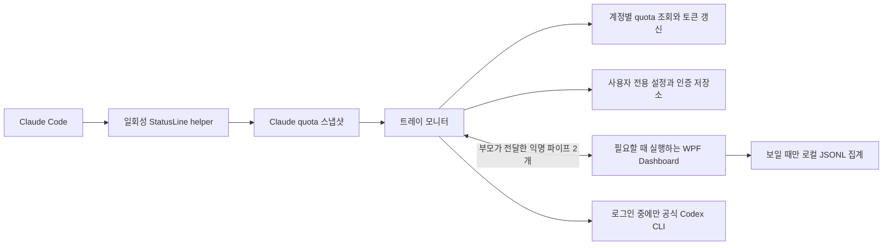

# QuotaBar macOS Windows 구현 계획

Windows에서도 **트레이에 상주하며 계정별 사용량을 조회하고, Dashboard를 열 때만 별도 화면 프로세스를 실행하는 구조**를 구현할 수 있다. 권장안은 macOS의 SwiftUI 앱을 유지하고 Windows에 C#/.NET 앱을 추가하는 것이다. 사용량 계산 규칙, 합성 테스트 데이터, 디자인 원본을 공유하고 OS 통합 코드는 플랫폼별로 둔다.

검토 기준은 2026-10-17, 저장소 `c7e697c`이다. 2026-10-18에 아래 계획의 Windows x64 시제품과 플랫폼 디렉터리 분리를 구현했다. 실제 검증 범위는 [Windows 검증 기록](WINDOWS_VALIDATION.md)을 기준으로 한다. 1차 대상은 기존 macOS 14 이상과 Windows 11 x64다. Windows ARM64와 WSL 연동은 별도 검증 단계로 둔다.

현재 적용 범위: 기존 Swift 소스·리소스·테스트는 `macos/`로 내용 변경 없이 이동했고, 공통 fixture를 읽는 Swift 테스트 하나를 추가했다. 기존 앱 식별자와 데이터 경로는 유지한다. Mac 실행 환경이 없으므로 `PlatformMac` 세부 추출과 Swift 내부 서비스 재배치는 보류했다. Windows에는 `Core`, `Windows`, `Protocol`, `Monitor`, `Dashboard`, `StatusLine` 프로젝트를 추가했다. 공통 로고·버전·합성 로그는 `shared/`에 두었다. 트레이 팝업은 Windows 네이티브 메뉴이며 WPF는 Dashboard 프로세스에만 로드한다. CI 설정은 추가했지만 이번 작업에서 원격 CI를 실행한 것은 아니다.

## 기능별 가능 범위

| 기능 | macOS 현재 동작 | Windows 계획과 차이 |
| --- | --- | --- |
| 상주 표시 | 메뉴바 아이콘과 긴 잔여량 문자열 | 최소 잔여 비율을 그린 숫자 아이콘(기본), 선택형 로고, 요약 툴팁, 우클릭 카드 메뉴. 좌클릭·더블클릭은 무동작. 긴 문자열의 상시 표시는 별도 미니창으로 제공 가능 |
| Dashboard | 필요할 때 helper 실행, 닫으면 종료 | 별도 WPF 프로세스로 동일한 수명주기 구현 |
| 다중 계정과 quota | Codex·Claude·Gemini, 실패 시 이전 성공 값 유지 | 같은 계정 식별·오류·잔여량 규칙을 C#으로 이식 |
| Codex 로그인 | 공식 CLI를 격리된 임시 홈에서 실행 | Windows 공식 CLI 탐색과 자식 프로세스 관리로 교체 |
| Codex 자동 갱신 | 앱 소유 인증만 회전, 새 토큰 먼저 저장 | 같은 순서와 계정별 중복 갱신 방지 유지 |
| Claude | CLI status line 스냅샷 수신 | Windows helper 및 Git Bash/PowerShell별 명령 실행·인용 처리 필요 |
| Gemini | Code Assist 파일 인증과 quota 조회 | 유효한 기존 Standard·Enterprise 계약 계정에 대한 조건부 지원 |
| 로컬 활동 | Codex·Claude JSONL, 26주 히트맵 | Windows 경로·파일 공유 모드를 반영한 파서와 같은 집계 규칙 |
| 절전과 저장 | NSWorkspace, POSIX 권한, 파일 잠금 | Windows 전원 이벤트, 사용자 ACL·DPAPI, 저장소 독점 잠금 |
| Dock 설정 | 앱의 Dock 표시를 켜고 끔 | Dashboard의 작업표시줄 표시 설정으로 별도 정의 |

Windows의 기본 알림 영역 API는 아이콘·툴팁·알림을 제공한다. macOS의 가변 너비 메뉴바 항목에 해당하는 긴 텍스트 영역은 제공하지 않으므로 위 표시 차이가 생긴다. 아이콘의 실제 노출/숨김은 Windows 사용자 설정에도 따른다. 기본 화면은 트레이 팝업으로 정하고, 미니창은 선택 기능으로 둔다. [Microsoft 알림 아이콘 API](https://learn.microsoft.com/en-us/windows/win32/api/shellapi/ns-shellapi-notifyicondataw), [팝업 구현 예제](https://learn.microsoft.com/en-us/windows/win32/shell/samples-notificationicon).

## 현재 코드에서 확인한 분리 지점

현재 Swift 소스는 앱 9개 파일 2,456줄, UsageCore 21개 파일 2,974줄이다. 테스트에는 9개 suite의 `@Test` 77개가 선언돼 있다. `UsageCore`라는 이름과 달리 OS 종속 코드도 포함되어 있어 폴더를 옮기는 작업만으로 Windows 빌드가 되지는 않는다.

| 현재 파일 | 확인한 의존성 또는 역할 | 구현 시 처리 |
| --- | --- | --- |
| [Package.swift](../macos/Package.swift) | macOS 14, SwiftUI 실행 파일 | macOS 패키지로 유지 |
| [App.swift](../macos/Sources/QuotaBar/App.swift), [Views.swift](../macos/Sources/QuotaBar/Views.swift) | AppKit·SwiftUI 화면, NSStatusItem | macOS 유지, Windows 화면 신규 작성 |
| [MonitorStore.swift](../macos/Sources/QuotaBar/MonitorStore.swift) | 조회·계정·상태와 UI·전원 이벤트가 함께 있음 | 조회 서비스와 화면 상태, OS 이벤트 처리를 분리 |
| [DashboardBridge.swift](../macos/Sources/QuotaBar/DashboardBridge.swift), [DashboardProtocol.swift](../macos/Sources/UsageCore/DashboardProtocol.swift) | 필요 시 helper 실행, 익명 파이프, 최대 4MiB 프레임 | 프로세스 역할과 메시지 경계 재사용, Windows 전송 구현 추가 |
| [CodexLogin.swift](../macos/Sources/UsageCore/CodexLogin.swift) | AppKit·Darwin, `/Applications`, `:` PATH, Unix 종료 신호 | 실행 파일 탐색·브라우저·프로세스 수명 어댑터 |
| [SecretVault.swift](../macos/Sources/UsageCore/SecretVault.swift) | `openat`, `fchmod`, `renameat`, 소유자·링크 검사 | macOS 구현 유지, Windows 저장소 별도 구현 |
| [CredentialMigration.swift](../macos/Sources/UsageCore/CredentialMigration.swift) | Security·LocalAuthentication, 이전 Keychain 이전 | macOS에만 배치 |
| [ClaudeSubscriptionConnection.swift](../macos/Sources/UsageCore/Upstream/ClaudeSubscriptionConnection.swift), [ClaudeSubscriptionStatusLine.swift](../macos/Sources/UsageCore/Upstream/ClaudeSubscriptionStatusLine.swift) | `/` 절대경로 판정, `/bin/sh`, POSIX quoting | Windows 경로·셸·helper 연결 구현 |
| [Account.swift](../macos/Sources/UsageCore/Account.swift), [ClaudeSubscriptionStore.swift](../macos/Sources/UsageCore/Upstream/ClaudeSubscriptionStore.swift) | 모델과 파일 저장 혼재, CryptoKit·POSIX 권한 | 모델·식별 규칙과 저장 어댑터 분리 |
| [LocalUsage.swift](../macos/Sources/UsageCore/LocalUsage.swift), [SessionProjectionReader.swift](../macos/Sources/UsageCore/Upstream/SessionProjectionReader.swift) | 스트리밍 projection, 중복·분기 제거, inode 캐시 | 알고리즘·기대값 공유, Windows File ID 및 공유 읽기 구현 |
| [scripts](../scripts) | Xcode, Bash, codesign, ICNS, libproc 측정 | macOS 스크립트와 Windows PowerShell 스크립트 분리 |

현재 Dashboard는 로컬 로그를 직접 집계하고 모니터는 계정·quota·저장을 소유한다. 새 브라우저 로그인은 Dashboard에서 시작해 결과를 부모 파이프로 한 번 전달한다. Windows에서는 모니터가 로그인 프로세스도 소유하고 화면에는 진행 상태만 전달하도록 한다. Dashboard 종료/연결 단절 시 해당 화면에서 시작한 미완료 로그인은 취소한다.

## 기술 선택

**macOS는 SwiftUI/AppKit, Windows는 .NET 10 LTS의 Windows Forms 트레이 모니터와 WPF Dashboard를 권장한다.** WPF 참조는 Dashboard 프로젝트에만 두어 상주 프로세스에서 WPF를 초기화하지 않는다. `NotifyIcon`과 WPF는 각각 이 역할을 지원한다. [.NET 지원 정책](https://dotnet.microsoft.com/en-us/platform/support/policy/dotnet-core), [NotifyIcon](https://learn.microsoft.com/en-us/dotnet/desktop/winforms/controls/notifyicon-component-windows-forms), [WPF](https://learn.microsoft.com/en-us/dotnet/desktop/wpf/overview/).

| 대안 | 장점 | 비용과 판단 |
| --- | --- | --- |
| Swift macOS + C# Windows | 기존 Mac 동작 보존, Windows OS 기능 직접 활용 | 핵심 규칙을 두 언어로 관리하므로 공통 테스트 데이터로 결과 일치 검증. 권장 |
| Swift 코어 공유 + Windows UI | 파서·조회 로직의 소스 공유 가능 | Swift의 Windows 지원은 존재하지만 AppKit·Darwin·암호화·프로세스 경계를 분리해야 하며, UI 언어 연결과 런타임 배포도 필요. 별도 PoC가 필요한 대안 |
| Rust/Tauri 또는 통합 웹 UI로 전환 | 장기적으로 공통 구현 확대 가능 | 기존 Mac UI·핵심 로직 재작성 범위가 커지고 화면 런타임의 성능 검증도 새로 필요. 첫 Windows 버전 범위에서 제외 |

Swift 자체가 Windows에서 불가능한 것은 아니다. 공식 Windows 개발·배포 지원이 있다. 이번 선택은 현재 앱의 보존 범위와 Windows 통합 비용을 기준으로 한 설계 판단이다. [Swift 플랫폼 지원](https://www.swift.org/platform-support/).

## 제안 저장소 구조

아래는 구현 후 목표 구조다. 현재 소스 이동은 수행하지 않는다.

```text
quotabar/
  macos/
    Package.swift
    Sources/
      QuotaBar/                   # SwiftUI, AppKit, 화면 상태
      UsageCore/                  # 계정, Provider, 집계, 스케줄 규칙
      PlatformMac/                # 경로, 저장, 로그인 프로세스, Keychain 이전
    Tests/
    scripts/                     # build, test, 아이콘, 성능 측정
  windows/
    QuotaBar.sln
    global.json                  # .NET SDK 고정
    src/
      QuotaBar.Core/             # 도메인 모델, Provider, OAuth, 집계, 스케줄
      QuotaBar.Windows/          # ACL/DPAPI, 경로, CLI, 전원, 프로세스
      QuotaBar.Protocol/         # 화면 명령, 상태 DTO, 프레임 처리
      QuotaBar.Monitor/          # WinForms 메시지 루프, NotifyIcon, 간단한 팝업
      QuotaBar.Dashboard/        # WPF, 계정 관리, 설정, 로컬 활동
      QuotaBar.StatusLine/       # stdin/stdout 전용 Claude callback
    tests/
    scripts/                     # build.ps1, test.ps1, package.ps1, measure.ps1
  shared/
    contracts/                   # 계정·quota·집계 의미, schemaVersion, 정규화 규칙
    fixtures/                    # 합성 입력과 기대 결과, 실계정 데이터 제외
    assets/                      # AppMark와 Provider 로고 원본
    version.json                # 제품 버전의 단일 원본
  scripts/                       # 기존 build.sh/test.sh 호환 진입점
  docs/
    PLATFORM_PLAN.md
    ARCHITECTURE.md
    VALIDATION.md
  .github/workflows/             # macOS와 Windows 각각 빌드·검증
  LICENSE
  NOTICE
```

`UsageCore`/`QuotaBar.Core`는 OS 서비스를 인터페이스로 받아 사용한다. 저장소·경로·CLI 실행·전원 이벤트·시간 공급을 주입하고, 구체 구현의 조합은 각 앱 진입점에서 한다. `PlatformMac`은 Swift 모델에 의존할 수 있으나 UsageCore가 다시 PlatformMac을 참조하는 순환 의존은 만들지 않는다.

공유 대상은 **규칙·데이터 계약·테스트 원본**이다. 첫 버전에서 Swift와 C# 코어의 바이너리나 전체 소스를 공유한다고 간주하지 않는다. 공통 테스트는 기대 출력과 양쪽 결과를 비교하며, 기존 구현의 알려진 오류까지 무조건 복제하지 않도록 기대값을 검토한다.

날짜는 공통 테스트에서 UTC ISO 8601, UUID는 정규화한 문자열, 토큰은 64비트 정수로 정의한다. 누락 quota와 0%를 구별하고, 컬렉션 순서를 정규화한다. Swift 기본 `Codable`의 enum·Date·UUID-key dictionary 표현을 C#이 자동으로 이해한다고 가정하지 않는다. 플랫폼 간 IPC 통신이나 기존 저장 파일의 직접 교환은 첫 버전 목표가 아니다.

## macOS 구현 작업

1. 소스·테스트·패키지를 `macos/`로 옮기는 변경과 동작 리팩터링을 분리한다. 기존 `bash scripts/build.sh`, `bash scripts/test.sh`는 새 위치를 호출하는 호환 진입점으로 유지한다.
2. `com.aiusage.lite`, Dashboard bundle ID, `~/Library/Application Support/AIUsage Lite`, 기존 계정 UUID와 저장 형식을 유지한다. 저장 경로나 앱 식별자 변경을 플랫폼 분리와 묶지 않는다.
3. `MonitorStore`에서 조회 큐·계정 변경·스케줄 계산을 서비스로 추출하고 SwiftUI 관찰 상태는 앱에 둔다. UI 변경 없이 3개 동시 조회와 실패 시 이전 값 유지부터 검증한다.
4. 경로·보안 파일·CLI 프로세스·Keychain 이전 구현을 `PlatformMac`으로 이동한다. POSIX 권한과 링크 거부, 토큰 원자적 저장의 기존 보장을 유지한다.
5. 공통 로고를 빌드 시 패키지 리소스 위치에 준비한다. `.app`과 내장 helper 모두 리소스를 포함하고 저장소 상대경로에 의존하지 않는지 검증한다. ICNS와 Windows ICO는 같은 원본으로 각각 생성한다.
6. 빌드 스크립트의 `Sources/...` 경로, 벤치마크 입력, 버전, README 실행법과 NOTICE 출처 경로를 함께 갱신한다. 77개 테스트와 패키징된 callback 검사, 실제 Mac의 창 닫기·재열기를 통과시킨다.

## Windows 실행 구조



- **모니터:** 계정·인증 저장과 quota 네트워크 요청의 단일 소유자다. 기본 5분, Dashboard를 닫거나 최소화하면 최소 15분, 동시에 최대 3계정, 같은 계정의 중복 요청 병합을 유지한다. 다음 마감에 일회성 타이머를 예약하고 전원 이벤트로 중지·재개한다.
- **트레이:** 선택한 활성 계정의 Provider별 최저 잔여율을 툴팁과 팝업에 표시한다. 이전 값 표시와 데이터 없음 표기를 유지한다. 팝업은 WinForms로 만들어 닫힐 때 해제하고, 상주 프로세스에 WPF를 로드하지 않는다. 모든 계정을 숨겨도 앱 아이콘과 Dashboard 진입은 남긴다.
- **Dashboard:** 열 때 시작하고 닫으면 종료한다. 최소화하면 로컬 스캔을 취소한다. 3개 화면과 테마, 26주 히트맵·모델 상세를 WPF로 구현하고 조회·저장 명령은 모니터로 보낸다. 작업표시줄/Alt+Tab과 macOS Dock의 차이는 Windows 설정으로 표현한다.
- **IPC:** 로컬 익명 파이프 두 개, 4바이트 big-endian 길이와 4MiB 상한을 유지한다. Windows 메시지는 명시적인 `version/type/requestId/payload`로 정의하고 버전 불일치를 거절한다. UI 스레드를 막지 않고 분할 읽기·EOF·시작 10초/응답 30초 제한을 검사한다. 부모의 자식용 handle 사본은 시작 직후 닫고 불필요한 handle 상속을 막는다. [.NET 익명 파이프](https://learn.microsoft.com/en-us/dotnet/api/system.io.pipes.anonymouspipeserverstream).
- **중복 실행:** 저장소 파일을 `FileShare.None`으로 열어 프로세스 수명 동안 독점한다. 재실행은 현재 사용자만 접근할 수 있는 활성화용 named pipe로 기존 창을 연다. 이 채널에는 창 열기 명령만 허용하고 다른 로그인 세션에서의 실행 충돌도 처리한다.
- **종료와 복구:** 부모 종료/IPC 단절 시 Dashboard를 종료하고 Explorer 재시작 시 트레이 아이콘을 다시 등록한다. 모니터가 소유한 helper는 Job Object로 정리하며, 시스템 기본 브라우저를 종료 대상에 포함하지 않도록 로그인 프로세스 경계를 PoC에서 확인한다. [Windows Job Objects](https://learn.microsoft.com/en-us/windows/win32/procthread/job-objects).

상주 HTTP 서버, Windows Service, 관리자 권한, 영구 로그 DB는 이 구조에 필요하지 않다. 로그인 callback은 공식 CLI가 로그인 중에만 연다.

## Windows 인증과 Provider

### 저장소와 경로

설정은 `%LOCALAPPDATA%\QuotaBar\settings.json`, 인증은 같은 루트의 `Credentials\<UUID>.bin`, Claude 연결은 `ClaudeProfiles\`에 저장한다. 설치 파일과 사용자 데이터는 분리한다. Windows의 인증 파일은 사용자 ACL과 DPAPI 사용자 범위 암호화를 적용하고 임시 파일도 처음부터 같은 권한으로 생성한다. 같은 사용자 권한의 다른 프로그램으로부터 완전한 격리를 제공하는 것은 아니다. [DPAPI](https://learn.microsoft.com/en-us/windows/win32/api/dpapi/nf-dpapi-cryptprotectdata).

1MiB 인증 크기 제한, 전체 쓰기 후 원자적 교체, 실패 시 이전 파일 유지, reparse point·hard link·소유권 검사에 대응하는 Windows 테스트를 만든다. 저장 실패를 무시하고 토큰 갱신을 반복하지 않는다. Mac 인증 파일을 Windows에 자동 복제하거나 DPAPI 파일을 기기 간 동기화하지 않는다.

CLI 홈은 `CODEX_HOME`, `CLAUDE_CONFIG_DIR`를 우선하고 기본값은 사용자 홈의 `.codex`, `.claude`, `.gemini`로 계산한다. Windows 경로 API로 드라이브·루트·공백·한글·대소문자와 중복 경로를 처리한다. WSL 경로를 단순 문자열 변환으로 지원 처리하지 않는다. 첫 버전은 Windows 네이티브 CLI를 대상으로 하고 WSL은 배포판·Linux 홈·실행 방식이 분리된 후속 어댑터로 다룬다.

### Codex

공식 Codex는 Windows 네이티브 실행과 파일 기반 로그인 저장을 지원한다. 현재 앱의 격리된 `CODEX_HOME` + `cli_auth_credentials_store="file"` 방식은 Windows에 이식할 근거가 있다. 조직이 파일 저장을 제한하는 경우 해당 실패를 표시한다. [Windows 지원](https://learn.chatgpt.com/docs/windows/windows-sandbox), [Codex 인증과 저장](https://learn.chatgpt.com/docs/auth).

- `PATH`의 `;` 구분과 `.exe/.cmd/.ps1` 설치 형태를 구별한다. 공식 native 실행 파일 또는 검증한 launcher를 사용하고 `ProcessStartInfo.ArgumentList`로 인자를 전달한다. npm shim에 셸 명령 문자열을 무작정 이어 붙이지 않는다. 데스크톱 앱 내부 경로는 고정된 공개 설치 계약으로 취급하지 않는다.
- 임시 홈 생성, API 키 관련 환경 제거, 기본 브라우저 열기, 300초 제한, 취소·실패·종료 정리를 이식한다. 다른 CLI 로그인 파일로 대체하지 않는다. 강제 종료 후 남은 앱 전용 임시 홈도 다음 시작 시 소유권과 실행 상태를 확인해 정리한다.
- 앱 로그인 계정만 갱신한다. 파일로 연결한 계정은 기존 CLI가 갱신한 내용을 계정 정체성이 일치할 때만 반영한다. 사용자·워크스페이스가 다른 응답은 거절한다.
- 계정별 갱신 병합, 새 refresh token의 선저장, 저장 재시도, 삭제/재연결 세대 검사, 인증 거부 시 한 번 재시도, 세션 해제 시 재로그인 대기를 유지한다.

현재 조회는 `chatgpt.com/backend-api/wham/usage`, 갱신은 기존 Codex OAuth client 설정에 의존한다. Windows에서 HTTP 요청을 구현할 수 있다는 사실과 이 endpoint의 장기 호환성은 별개다. 초기 검증에 실제 로그인·조회·만료 후 갱신을 포함하고, Provider를 교체 가능한 어댑터로 둔다.

### Claude

공식 문서에 5시간·7일 `rate_limits`와 Windows status line 실행 방식이 있다. Windows에서는 Git Bash가 있으면 이를 사용하고, 없으면 PowerShell을 사용하므로 실행 셸을 하나로 가정하면 안 된다. 지원 세션에서도 첫 응답 전이나 필드가 없을 때는 대기 상태를 표시한다. [Claude status line](https://code.claude.com/docs/en/statusline#windows-configuration).

- 토큰을 가져오지 않고 선택한 CLI 설정 폴더의 `statusLine`만 연결한다. 별도 `QuotaBar.StatusLine.exe`는 UI와 모니터를 시작하지 않는다.
- Windows helper 경로의 `/` 표기와 셸별 quoting을 구현한다. 공백·한글·작은따옴표가 있는 경로, Git Bash 존재/부재를 모두 검사한다. 기존 명령은 실제 실행 셸에 맞춰 stdin/stdout/종료 코드를 보존한다.
- `settings.json`의 다른 필드와 연결 후 사용자 수정을 보존하고, 앱이 설치한 명령이 그대로 남아 있을 때만 복구한다. 재연결 시 중복 wrapper를 만들지 않는다.
- 프로필 ID·generation·스냅샷 유효기간을 유지하고 기존 stdout에 디버그 로그를 섞지 않는다. 읽기 시작부터 입력 크기를 제한하고, quota를 저장하지 못해도 기존 status line의 출력을 유지한다.
- 설치/업데이트 후 helper 경로를 안정적으로 유지한다. Portable 폴더 이동은 재연결로 처리하고, 제거 전 status line 복구 절차를 제공한다.

### Gemini

개인용 Code Assist·Google AI Pro/Ultra의 해당 CLI 로그인 지원은 2026-06-18부터 종료됐다. Standard·Enterprise도 2026-10-09부터 신규 구독을 판매하지 않으며 기존 계약은 계약 종료까지 지원한다. 따라서 기존 유효 계약 계정에 대한 조회 호환만 검증하고 새 개인 계정 연결을 약속하지 않는다. [개인 계정 안내](https://developers.google.com/gemini-code-assist/docs/deprecations/code-assist-individuals), [Standard·Enterprise 종료 일정](https://docs.cloud.google.com/gemini/docs/codeassist/sunset).

기존 코드의 파일 가져오기·계정 일치 확인·Pro/Flash/Flash Lite 집계와 갱신 미지원 동작을 이식한다. `v1internal` endpoint의 응답을 검증할 실제 지원 계정이 없으면 미검증 상태를 명시한다. Antigravity 지원은 별도 Provider 개발 범위다.

## 로컬 집계와 공통 검증

현재 77개 테스트를 기반으로 언어와 무관한 합성 입력·기대 출력부터 추출한다. Swift 테스트 코드를 C#에서 실행할 수 있다고 가정하지 않는다. 순수 계산은 양쪽에서 같은 fixture를 실행하고, Keychain/POSIX 및 Windows ACL/DPAPI 검사는 각 플랫폼에 둔다. 로그인 테스트의 `/bin/sh`, `/bin/sleep`, macOS `stat` 모의 실행 파일도 Windows용으로 교체한다.

반드시 보존할 동작은 다음과 같다.

- 같은 이메일의 다른 사용자·워크스페이스를 분리하고 Provider 요청 캐시와 인증 헤더를 계정별로 격리한다. unknown quota를 100%로 만들지 않는다.
- Claude streaming 기록, Codex 누적 기록·복사본·archived session·분기 원본을 중복 계산하지 않는다. cache token을 total에 두 번 더하지 않는다.
- 날짜 경계, DST, 30/45분 시간대, 연도 변경, 오래된 부모 baseline을 검증한다. 통계는 기기 단위이며 임의로 현재 계정에 귀속하지 않는다.
- 대화 본문·도구 입력은 스트림에서 건너뛴다. 전체 로그를 `ReadAllText`/전체 JSON 객체로 올리지 않는다. 128파일·2만 캐시 이벤트·25만 처리 이벤트 상한과 불완전 통계 표시를 유지한다.
- Windows에서 쓰는 중인 파일은 공유 읽기로 열고, UTF-8·CRLF·마지막 미완성 행·파일 교체/삭제를 처리한다. 파일 식별자·수정 시각·크기로 캐시를 무효화한다.
- Dashboard가 보이고 활동 탭을 선택한 때만 최대 5분 간격으로 집계한다. 창 닫기/최소화 시 취소하며 재열기에서 최신 로그를 다시 읽는다.

## 구현 순서와 완료 조건

| 단계 | 산출물 | 완료 조건 |
| --- | --- | --- |
| 0. Windows 기술 검증 | 트레이·별도 창·격리 로그인·status line 최소 프로그램 | 창을 닫으면 화면 프로세스 종료, 모니터 유지. 공백/한글 경로에서 두 CLI 연동과 취소 정리 확인. 대기 자원 측정으로 기술 선택 확인 |
| 1. 플랫폼 폴더 분리 | `macos/`, `windows/`, 호환 스크립트, 공통 로고 | Mac 빌드·77개 테스트·패키징 callback 통과, 기존 설정·계정 ID·데이터 경로 유지 |
| 2. 규칙과 기반 계층 | 공통 fixtures, C# Core/Windows/Protocol, 저장소 | 계정 식별·quota·스케줄 fixture 일치. 손상 설정 보존, ACL/DPAPI·원자적 저장·단일 인스턴스 검사 통과 |
| 3. Codex와 Claude | Provider, OAuth 상태 관리, helper | 모의 서버로 실패·동시 갱신·삭제 경쟁 통과. 실제 지원 계정으로 로그인·quota·갱신 및 Claude callback/복구 확인 |
| 4. Windows 화면과 활동 | 트레이 팝업, WPF 3개 화면, JSONL 집계 | 계정/테마 설정 왕복, 공통 집계 결과 일치, 100/150/200% DPI·키보드·다중 모니터·절전 복귀 확인 |
| 5. Gemini 호환 | 지원 계약용 adapter, 상태 안내 | 합성 응답 검증과 실제 지원 계정 조회. 후자를 못 하면 출시 문서에서 미검증 범위를 명시 |
| 6. 배포와 회귀 | OS별 CI, Windows x64 패키지, 검증 기록 | 깨끗한 PC에서 설치·실행·업데이트·제거, helper 경로/복구, 프로세스 종료와 자원 회귀 확인 |

0단계가 첫 작업이다. 큰 폴더 이동과 전 기능 이식에 앞서 Windows 로그인·Claude 셸 처리·프로세스 분리의 실제 동작을 확인한다. 첫 사용 가능한 범위는 Codex·Claude와 기본 Dashboard로 구성하고, 공통 집계·Gemini 조건부 지원·패키징까지 이어서 완성한다.

macOS CI는 Swift 6 이상으로 기존 suite와 패키징 검사를 수행한다. Windows CI는 .NET 10 SDK를 고정하고 합성 fixture·모의 CLI/HTTP·실제 로컬 파이프·callback을 검증한다. 실계정 검증은 사용자 환경에서 별도로 기록하며 CI에 인증 파일을 넣지 않는다. `.gitignore`에는 `bin/`, `obj/`, `.vs/`와 패키징 산출물을 추가한다.

Windows 첫 패키지는 런타임을 포함한 x64 폴더형 ZIP으로 만들고 개발 SDK 설치 없이 실행되는지 검사한다. helper는 안정적인 상대 위치에 둔다. 0.2.2 프리뷰에 사용자별 설치 EXE를 추가했으며 신규 설치·같은 버전 재설치·제거를 검증한다. 공개 정식 배포에서는 Authenticode 서명과 다른 버전 간 업데이트, 제거 시 callback 복구를 추가 검증한다. 현재 Claude 연결은 제거 전에 앱에서 해제한다. Mac은 현재 ad-hoc 서명과 공개 배포용 서명·공증을 구별해 기록한다. Apache-2.0 LICENSE와 NOTICE는 두 패키지에 모두 포함한다.

## 성능 기준과 이번 확인 범위

기존 [VALIDATION](VALIDATION.md)의 약 31–33MB는 특정 Mac의 `phys_footprint` 측정 기록이다. Windows의 Private Bytes나 Working Set과 같은 지표가 아니며 Windows 메모리 보장값으로 사용하지 않는다.

Windows는 같은 계정 수·합성 로그에서 시작 직후, Dashboard 사용 중, 여러 차례 닫은 뒤의 모니터/자식 프로세스 전체를 측정한다. 60초 안정화 후 90초 이상 관찰하고 Private Bytes·Working Set·CPU·handle 수·프로세스 수를 기록한다. 닫은 뒤 Dashboard가 남지 않고 반복 개폐에 따라 자원이 누적되지 않는지 확인한다. 조회 사이 반복 타이머와 숨겨진 상태의 로그 스캔이 없어야 한다. 로그 cold/warm 처리와 창 열기 지연은 별도로 측정하며 수치 목표는 0단계 실측으로 정한다.

이번 검토에서는 소스와 테스트 정의, 기존 검증 문서, 공식 플랫폼 문서를 확인했다. 현재 Windows 실행 환경의 PATH에는 Swift가 없고 기본 `dotnet --info`에는 .NET 8 런타임만 있으며 SDK는 없다. Mac 테스트 재실행, Windows 프로그램 빌드, 실계정 로그인·네트워크 조회는 이번 계획 작성에 포함하지 않았다. 구현 시작 시 .NET SDK와 Mac 검증 환경을 먼저 준비한다.
